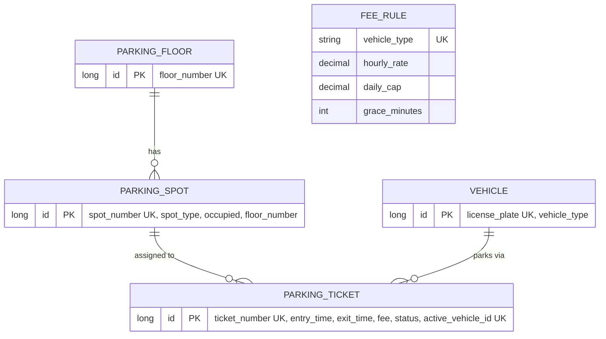

# Smart Parking Lot System

Backend (Spring Boot 3 / Java 17) for a multi-floor urban parking lot. It handles vehicle entry and exit,
assigns spots by vehicle size, calculates fees from time parked, and keeps availability up to date in real time.

## What the system can do

| Capability | How |
|---|---|
| **Spot allocation** | On check-in, a spot is chosen automatically from the vehicle type (motorcycle, car, bus) using a best-fit policy. |
| **Check-in / check-out** | Entry and exit instants are recorded on a *ticket*. A vehicle can have only one active ticket. |
| **Fee calculation** | Fee depends on time parked and vehicle type: hourly rate, a free grace period, and a daily cap. |
| **Real-time availability** | Counts per spot type, per floor and per vehicle type, as a REST snapshot and a live Server-Sent-Events stream. |
| **Concurrency safety** | Simultaneous entries and exits never double-book a spot, create duplicate sessions or double-charge. |
| **Lot configuration** | Floors and spots are created through an admin API (a demo lot is seeded on first start). |

## Quick start

```bash
mvn spring-boot:run                      # in-memory H2, demo lot seeded
mvn test                                 # unit + integration + concurrency tests
mvn spring-boot:run -Dspring-boot.run.profiles=postgres   # PostgreSQL (DB_URL, DB_USER, DB_PASSWORD)
```

Demo lot: floor 0 (10 small / 20 medium / 2 large), floor 1 (5 / 25 / 2), floor 2 (0 / 30 / 0).
Disable with `parking.seed.sample-lot=false`.

## API

Base path `/api/v1`. Errors use RFC 7807 `ProblemDetail` JSON.

| Method & path | Purpose | Success | Errors |
|---|---|---|---|
| `POST /parking/check-in` | `{ "licensePlate": "KA01AB1234", "vehicleType": "CAR" }`: allocate a spot and open a ticket | 201 + ticket | 400 invalid, 409 lot full / already parked |
| `POST /parking/check-out` | `{ "ticketNumber": "TKT-..." }`: close the ticket, charge, free the spot | 200 + ticket with final fee | 404 unknown, 409 already checked out |
| `GET /parking/tickets/{ticketNumber}` | Ticket status; for active tickets the fee is a running estimate | 200 | 404 |
| `GET /parking/availability` | Snapshot of total and free spots | 200 | |
| `GET /parking/availability/stream` | SSE: current snapshot, then an `availability` event after each committed change | 200 | |
| `POST /admin/floors` | `{ "floorNumber": 3, "smallSpots": 10, "mediumSpots": 40, "largeSpots": 4 }` | 201 | 409 floor exists, 400 empty floor |

```bash
curl -X POST localhost:8080/api/v1/parking/check-in -H 'Content-Type: application/json' \
     -d '{"licensePlate":"KA01AB1234","vehicleType":"CAR"}'
curl -X POST localhost:8080/api/v1/parking/check-out -H 'Content-Type: application/json' \
     -d '{"ticketNumber":"TKT-0123456789AB"}'
curl -N localhost:8080/api/v1/parking/availability/stream
```

License plates are normalised (trimmed, upper-cased, spaces and hyphens removed), so `ka-01 ab1234` and `KA01AB1234` are the same vehicle.

## Design

### Layers

```
web (controllers, DTOs, exception handler)
  -> service (ParkingService, AvailabilityService, FloorAdminService, FeeCalculator)
       -> strategy (SpotAllocationStrategy <- BestFitSpotAllocationStrategy)
       -> repository (Spring Data JPA)  -> database
event (AvailabilityChangedEvent) -> AvailabilityEventListener -> AvailabilityBroadcaster (SSE)
```

### Data model



Full DDL: [`docs/schema.sql`](docs/schema.sql). Notable choices:

* `parking_spot.occupied` is the source of truth for availability, so counts cannot drift.
* `parking_ticket.vehicle_type` is a snapshot taken at entry, so billing is unaffected by later changes to the vehicle.
* `parking_ticket.active_vehicle_id` is set while the ticket is ACTIVE and null afterwards. Its unique constraint enforces one active session per vehicle in a way that works on any database.
* `parking_spot.floor_number` is denormalised so the allocation query needs no join and locks only spot rows.

### Spot allocation (best fit)

| Vehicle | Allowed spots, in order tried |
|---|---|
| Motorcycle | SMALL, MEDIUM, LARGE |
| Car | MEDIUM, LARGE |
| Bus | LARGE |

For each allowed type in order, take the free spot with the lowest floor, then the lowest spot number, and lock it. Smaller vehicles use the smallest spot that fits, which keeps large spots free for buses. Within a type, lower floors fill first, which means a shorter drive to the exit. The policy sits behind `SpotAllocationStrategy`, so it can be swapped (for example for nearest-to-entrance or EV-charger spots).

### Fee calculation

Rules live in `fee_rule` (defaults below, editable in the database):

| Vehicle | Per started hour | Daily cap | Free grace |
|---|---|---|---|
| Motorcycle | 10.00 | 100.00 | 15 min |
| Car | 20.00 | 200.00 | 15 min |
| Bus | 50.00 | 500.00 | 15 min |

1. Duration is rounded up to whole minutes.
2. A stay no longer than the grace period is free.
3. Otherwise every *started* hour is charged at the hourly rate.
4. Each full 24h block costs the daily cap. The remainder is charged hourly, never above the cap.

Examples (car): 15 min is 0; 16 min is 20; 61 min is 40; 10 h is 200; 25 h is 220. The logic is a pure class (`FeeCalculator`) and uses an injected `Clock`, so it is fully unit-testable.

### Concurrency

| Risk | Protection |
|---|---|
| Two cars get the same spot | Allocation uses `SELECT ... FOR UPDATE SKIP LOCKED` inside the check-in transaction. Each request locks a different free row, with no waiting and no double-booking. If free spots exist but are momentarily locked by in-flight check-ins, the allocator retries briefly before reporting the lot full. |
| Same plate checks in twice at once | The unique `active_vehicle_id` column and the unique `license_plate` column. The loser rolls back with 409, and its spot lock is released with it. |
| Double check-out of one ticket | The ticket row is locked (`PESSIMISTIC_WRITE`), so the second request sees `COMPLETED` and gets 409. |
| Partial failure | Spot, ticket and vehicle changes share one transaction, so they succeed or roll back together. |
| Stale live updates | SSE events are sent `AFTER_COMMIT`, so rolled-back changes are never broadcast. |

`ConcurrencyIntegrationTest` fires 12 simultaneous check-ins at 3 spots and asserts exactly 3 succeed on 3 distinct spots. It also covers racing check-ins of the same plate and racing check-outs of the same ticket.

## Project layout

```
src/main/java/com/smartparking
  config/      Clock bean, fee-rule + demo-lot seeding
  domain/      JPA entities and enums
  repository/  Spring Data repositories (incl. locking queries)
  strategy/    Spot allocation policy
  service/     Business logic, fee calculator, availability + SSE broadcasting
  event/       Domain events
  web/         REST controllers, DTOs, global exception handler
docs/schema.sql  Reference PostgreSQL DDL
```

## Assumptions and next steps

* The admin API is unauthenticated; add Spring Security (role-based) before real use.
* Fee rules are seeded with defaults; an admin endpoint to edit them is a natural next step.
* Multi-instance deployments work as-is (all locking is in the database). The SSE broadcast reaches only clients connected to the instance that handled the change; use a message broker for cross-instance fan-out.
* Possible extensions: reservations, EV-charging spots, payment integration, lost-ticket handling, Flyway migrations.
